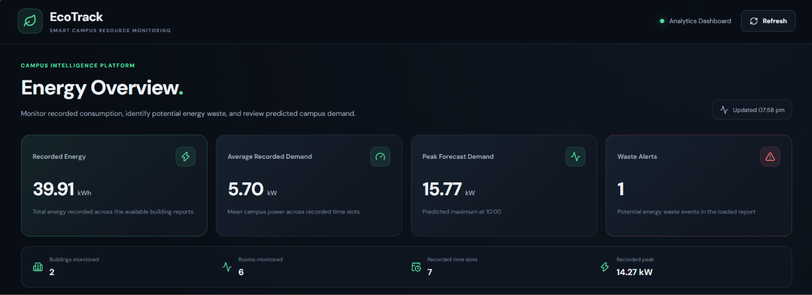
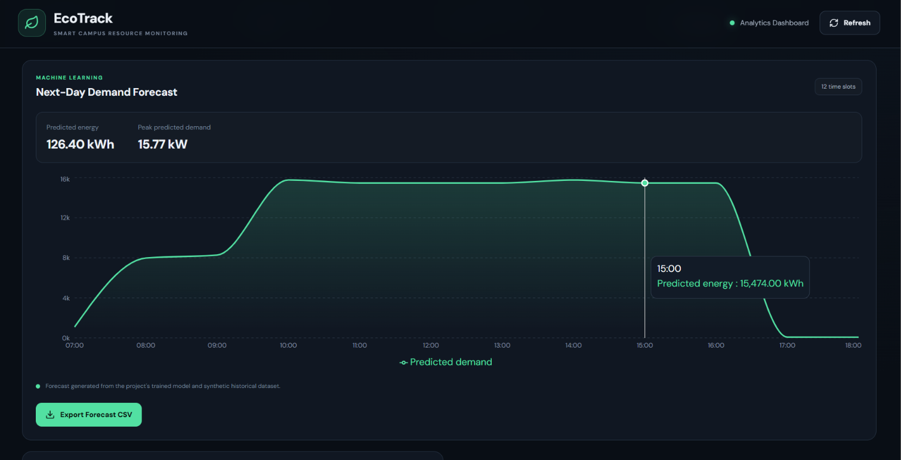
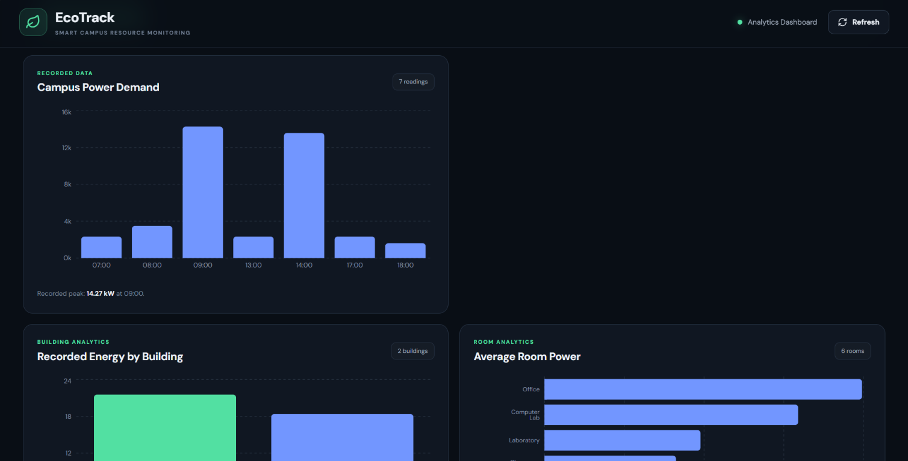
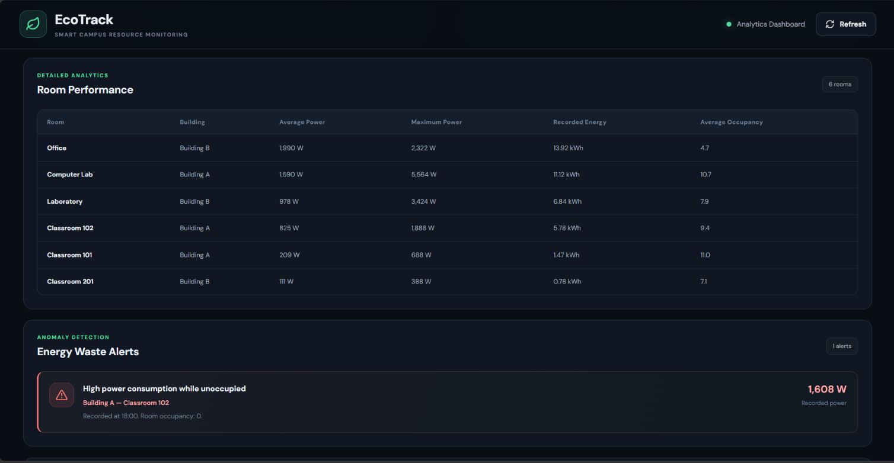
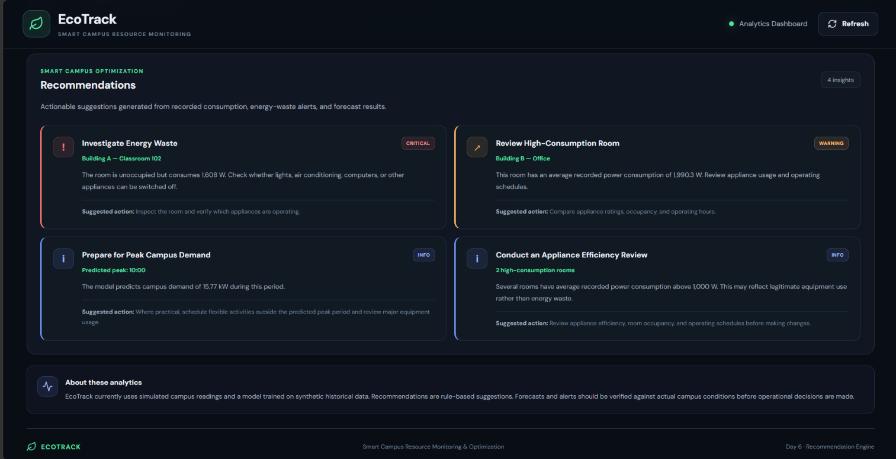

\# EcoTrack — Smart Campus Energy Monitoring \& Optimization


A Python-powered campus energy simulation and analytics system that identifies

potential energy wastage, analyzes electricity consumption, and forecasts

future energy demand through machine learning.


EcoTrack combines a simulated campus environment, energy analytics, anomaly

detection, a Random Forest regression model, and an interactive React dashboard

to demonstrate how data-driven techniques can support energy management.


\---


\## Project Overview


Educational institutions use electricity across classrooms, laboratories,

computer labs, and administrative offices. Understanding where and when energy

is consumed can help identify inefficient usage and opportunities for

conservation.


EcoTrack simulates electricity consumption across campus rooms, analyzes

recorded readings, detects potential energy wastage, and generates

hourly energy-demand forecasts.


The project demonstrates an end-to-end data pipeline using Python, Firebase

Firestore, machine learning, and React.


\*\*Important:\*\* This is an educational simulation. The energy readings and

historical training data are synthetic. Forecast accuracy on synthetic data

does not establish accuracy for a real campus.


\## Key Features


\- \*\*Campus Energy Simulation:\*\* Simulates electricity consumption across

&#x20; six rooms in two campus buildings.

\- \*\*Energy Analytics:\*\* Generates campus-, building-, and room-level

&#x20; consumption reports.

\- \*\*Energy-Waste Detection:\*\* Flags readings where a room has zero occupancy

&#x20; but power consumption exceeds the configured threshold.

\- \*\*Machine Learning Forecasting:\*\* Uses a Random Forest regression model to

&#x20; estimate hourly room-level power consumption.

\- \*\*Peak Demand Analysis:\*\* Identifies peak recorded demand and estimates

&#x20; future peak demand.

\- \*\*Recommendation Engine:\*\* Produces rule-based recommendations from

&#x20; consumption, alerts, and forecast data.

\- \*\*Interactive Dashboard:\*\* Presents metrics, charts, alerts, and

&#x20; recommendations through a React interface.

\- \*\*CSV Export:\*\* Stores reports and supports exporting hourly forecast data.

## Dashboard Preview

### Screenshot 1 — Dashboard Overview


### Screenshot 2 — Energy Consumption Analytics


### Screenshot 3 — Energy Demand Forecast


### Screenshot 4 — Energy-Waste Detection


### Screenshot 5 — Recommendations and Insights

\## System Architecture


```text

&#x20;      Campus Simulation

&#x20;            |

&#x20;            v

&#x20;     Python Simulator

&#x20;            |

&#x20;            v

&#x20;      Energy Readings

&#x20;            |

&#x20;      +-----+------+

&#x20;      |            |

&#x20;      v            v

&#x20;Firebase        CSV Data

&#x20;Firestore       Reports

&#x20;      |            |

&#x20;      v            v

&#x20;Python Analytics   React Dashboard

&#x20;      |

&#x20;      v

&#x20;Historical Data Generation

&#x20;      |

&#x20;      v

&#x20;Random Forest Model

&#x20;      |

&#x20;      v

&#x20;Energy Demand Forecast

&#x20;      |

&#x20;      v

&#x20;React Dashboard

```


The simulator generates readings, which can be uploaded to Firestore.

The analytics and forecasting scripts process data and generate CSV reports.

The dashboard currently reads prepared CSV files from its public data folder.


\*\*Current implementation:\*\* The dashboard is CSV-based and does not update

automatically from live Firestore readings.


\## Technology Stack


| Technology | Purpose |

|---|---|

| Python | Simulation, analytics, anomaly detection, and forecasting |

| NumPy | Numerical computation |

| Pandas | Data processing and report generation |

| Scikit-learn | Random Forest regression |

| Joblib | Saving and loading the trained model |

| Firebase Firestore | Cloud storage for simulated readings |

| Firebase Admin SDK | Python integration with Firestore |

| React | Dashboard user interface |

| Vite | Frontend development server and build tooling |

| Recharts | Charts and data visualization |

| Lucide React | Dashboard icons |

| CSV | Data exchange between project components |

| Git and GitHub | Version control and source-code hosting |


\## Campus Simulation


The current simulation includes two buildings and six rooms.


| Building | Room |

|---|---|

| Building A | Classroom 101 |

| Building A | Classroom 102 |

| Building A | Computer Lab |

| Building B | Classroom 201 |

| Building B | Laboratory |

| Building B | Office |


The simulator generates readings at seven time points:


`07:00, 08:00, 09:00, 13:00, 14:00, 17:00, 18:00`


This produces 42 simulated readings for the current dataset.


Each reading can contain fields such as timestamp, building, room, occupancy,

voltage, current, power, and energy.


\## Energy-Waste Detection


EcoTrack uses a configurable rule to identify potential energy wastage:


```text

IF occupancy == 0 AND power > 500 W:

&#x20;   Flag a potential energy-waste event

```


For example, the current sample dataset contains an alert for Classroom 102

in Building A at 18:00, with zero occupancy and recorded simulated power

of 1608 W.


This rule identifies a condition worth investigating; it does not prove that

the energy is being wasted in a real building.


\## Machine Learning Forecasting


EcoTrack uses a Random Forest regressor to estimate room-level power demand.


\### Model inputs


The model uses the following features:


\- Weekday

\- Weekend indicator

\- Hour of the day

\- Building

\- Room

\- Occupancy


\### Training dataset


The synthetic historical dataset contains 2,160 records, generated from

30 days, 12 hourly time points, and six rooms.


The chronological evaluation split uses the first 24 days for training

and the final six days for testing.


\### Recorded evaluation results


| Metric | Result |

|---|---:|

| Training records | 1,728 |

| Test records | 432 |

| Mean Absolute Error (MAE) | 41.05 W |

| Root Mean Squared Error (RMSE) | 244.75 W |

| R-squared (R²) | 0.979 |

| Unoccupied-record MAE | 81.96 W |


These results are from the current synthetic dataset and model configuration.

They must not be interpreted as validated performance on real campus data.


The evaluation also showed that rare high-power events during unoccupied

periods were not reliably predicted. For this reason, the separate

rule-based energy-waste detector is retained rather than relying on the

forecast model to detect such events.


\## Example Forecast


The current generated forecast contains 72 room-hour predictions:

six rooms across twelve hourly time points.


| Forecast metric | Current example |

|---|---:|

| Total predicted energy | 126.40 kWh |

| Peak predicted demand | Approximately 15.77 kW |

| Forecast peak time | 10:00 |


These are outputs from the current synthetic forecasting setup, not measured

or verified predictions for an actual campus.


\## Project Structure


```text

Ecotrack/

├── analytics/

│   └── analytics.py

├── data/

│   ├── sample\_data.csv

│   ├── campus\_power\_report.csv

│   ├── building\_report.csv

│   ├── room\_report.csv

│   ├── peak\_usage\_report.csv

│   ├── energy\_waste\_alerts.csv

│   ├── historical\_energy\_data.csv

│   ├── prediction\_evaluation.csv

│   └── next\_day\_forecast.csv

├── firebase/

│   ├── firebase\_config.py

│   └── upload\_data.py

├── models/

│   └── energy\_prediction\_model.joblib

├── prediction/

│   ├── generate\_history.py

│   ├── train\_model.py

│   └── predict\_energy.py

├── simulator/

│   ├── appliances.py

│   ├── campus.py

│   ├── energy.py

│   ├── anomaly.py

│   └── simulator.py

├── dashboard/

│   ├── public/

│   │   └── data/

│   └── src/

│       ├── App.jsx

│       ├── App.css

│       ├── index.css

│       ├── main.jsx

│       └── recommendations.js

├── .gitignore

└── README.md

```


Firebase credentials are intentionally excluded from the repository.


\## Getting Started


\### Prerequisites


Install the following:


\- Python 3.12 or a compatible Python version

\- Node.js and npm

\- Git

\- A Firebase project with Firestore enabled, if you want to run the cloud

&#x20; upload component


\### 1. Clone the repository


```bash

git clone https://github.com/Alwyn07/ecotrack-smart-campus.git

cd ecotrack-smart-campus

```


\### 2. Set up the Python environment


Windows PowerShell:


```powershell

python -m venv .venv

.\\.venv\\Scripts\\Activate.ps1

```


If PowerShell blocks activation, you can use the environment's Python

executable directly:


```powershell

.\\.venv\\Scripts\\python.exe --version

```


Install the required packages:


```powershell

python -m pip install numpy pandas scikit-learn joblib firebase-admin

```


\### 3. Run the campus simulator


From the project root:


```powershell

python .\\simulator\\simulator.py

```


The simulator generates campus energy readings according to its configuration.


\### 4. Generate synthetic historical data


```powershell

python .\\prediction\\generate\_history.py

```


\### 5. Train the forecasting model


```powershell

python .\\prediction\\train\_model.py

```


The script trains and evaluates the model and saves the trained model under

the `models/` directory.


\### 6. Generate a forecast


```powershell

python .\\prediction\\predict\_energy.py

```


The forecast is written to the project's data directory.


If the dashboard's prepared data needs updating, copy the generated CSV reports

into `dashboard/public/data/` before running the frontend.


\### 7. Run the dashboard


Open another terminal:


```powershell

cd dashboard

npm install

npm run dev

```


Open the local address printed by Vite, typically:


`http://localhost:5173/`


The dashboard uses prepared CSV files from `dashboard/public/data/`.


\## Firebase Configuration (Optional)


Firebase is used to store simulated readings in Firestore.


To enable the upload component:


1\. Create or select a Firebase project.

2\. Enable Cloud Firestore.

3\. Create a service account with the necessary permissions.

4\. Download its service-account JSON key.

5\. Store the file at:


&#x20;  `firebase/serviceAccountKey.json`


6\. Confirm that the credential path used by the Firebase configuration

&#x20;  matches this location.

7\. Run the upload script only when you intend to upload a new batch of data.


\*\*Security warning:\*\* Never commit service-account keys, passwords, API secrets,

or other credentials to GitHub. The service-account file is excluded through

`.gitignore`.


The dashboard currently does not subscribe to live Firestore updates.


\## Current Limitations


\- Energy readings are simulated rather than collected from physical meters.

\- Historical training data is synthetic.

\- Forecast performance has not been validated on real campus data.

\- Rare high-power events are not reliably predicted by the regression model.

\- Energy-waste detection uses a fixed rule and threshold.

\- Dashboard data is loaded from CSV files rather than live Firestore queries.

\- Recommendations are rule-based.

\- The system does not automatically switch off appliances or control

&#x20; electrical equipment.

\- The current simulation represents a small campus with six rooms.


\## Future Enhancements


\- Integrate real energy meters and occupancy sensors.

\- Validate and retrain the model using real historical consumption data.

\- Add live Firestore integration to the dashboard.

\- Introduce authentication and role-based access.

\- Improve anomaly detection using historical baselines and contextual rules.

\- Add configurable energy-saving targets and cost estimates.

\- Deploy the dashboard as a publicly accessible web application.

\- Investigate safe, authorized building-management integrations.


\## Educational Objectives


EcoTrack demonstrates:


\- Simulation of an energy-monitoring environment

\- Data processing and aggregation with Pandas

\- Rule-based anomaly detection

\- Supervised machine learning with Random Forest regression

\- Model evaluation using MAE, RMSE, and R²

\- Cloud data storage with Firebase Firestore

\- Interactive data visualization using React and Recharts

\- Integration of Python data-processing scripts with a web dashboard


\## Repository


GitHub: https://github.com/Alwyn07/ecotrack-smart-campus


\## Disclaimer


EcoTrack is an educational software project. Its simulated readings and

forecasts are intended for demonstration and learning purposes only.

They should not be used as the basis for real electrical control or

operational energy-management decisions without appropriate validation.


\## Author


\*\*Alwyn Basil Eldho\*\*


Developed as an academic project exploring smart-campus energy monitoring,

data analytics, and machine learning.

